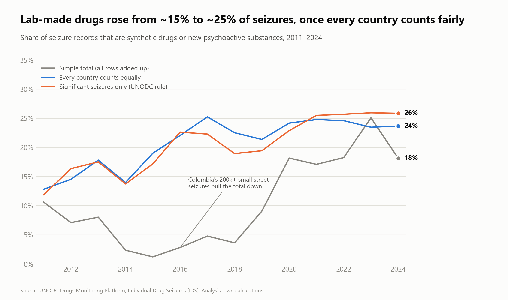

# Drug Seizures Explorer

Interactive analysis of **2.8 million drug seizures** reported to the United Nations (UNODC) from 2011 to mid-2026,
with an early-warning view for the **Middle East and North Africa (MENA)**.

Built with **Python** (pandas, Plotly, Streamlit). Data: **UNODC Drugs Monitoring Platform**.



## What the project shows

| Question | Finding |
|---|---|
| Is the world shifting from plant-based to lab-made drugs? | **Yes, slowly.** Synthetic drugs and new psychoactive substances rose from about **16% to 26%** of seizure records (2012 → 2024) when every country counts equally and only "significant" seizures are used. |
| Can the raw data be trusted as it is? | **No.** Colombia alone was up to **90% of all records** (2015), and 79% of records are small street seizures that only some countries report. Simple totals mislead; the project corrects for both. |
| Records or weight? | Both are needed: lab-made drugs are **26% of seizures but 11% of the weight** (many small seizures). |
| Where is the shift strongest? | **Asia** (about 43% lab-made, rising); the Americas and Africa remain mostly plant-based. |
| Did COVID-19 change seizures? | In **April 2020** seizures fell to about **one third of normal** (same 20 countries every year), then recovered. |
| What is changing in MENA? | 41 early-warning signals (new, growing or spreading drugs) with a reliability level, e.g. methamphetamine first recorded in Egypt in 2020, MDMA growing across MENA. |

## The app

`app/app.py` is a Streamlit app with 7 tabs:

- **Overview**: totals, yearly trend by drug group (totals or % of each year), top drugs and countries, world map
- **Country profile**: plain-English summary, "what stands out" notes (reporting gaps, unusual drug mix, etc.), comparison with the rest of the region
- **Drug profile**: trend, top countries and map for any drug (most common first)
- **COVID-19**: monthly seizures 2019-2021 against a 2018-2019 baseline
- **MENA early warning**: drugs that are new in a country, growing, or spreading to more countries
- **Data & downloads**: the filtered table
- **FAQ**: short answers in plain language

Filters for years, region, country, drug group and drug apply across the app. Every table downloads as **Excel**, every chart saves as **PNG**.

## Method in brief

1. **Load and combine** 16 yearly sheets from 3 Excel files into one table (column names differ between files).
2. **Clean without deleting rows**: problems are flagged (duplicates, impossible weights, incomplete years 2025-2026) so each analysis can choose what to exclude.
3. **Classify 343 drug names** into plant-based, synthetic, pharmaceutical and new psychoactive substances (`data/reference/drug_class_lookup.csv`, 185 names classified by hand).
4. **Compare fairly**: five methods (simple total, without Colombia, every country equal, consistent reporters, significant seizures only). A finding counts only if it holds across the fair methods.
5. **Early-warning signals** for MENA with checks for reporting artifacts, e.g. a country starting to *name* a drug it used to record under a general category.
6. **Report library** (next step: AI assistant): 11 UNODC, INCB and EMCDDA reports, 1,192 pages; 27 of 41 signals have a paragraph naming the same drug and country.

Details: [`reports/`](reports/) (quality check, cleaning log, findings, signals, report coverage).

## Run it

```bash
pip install -r requirements.txt
streamlit run app/app.py
```

The app runs on the aggregated tables in `app/data/` (one row per year, country and drug).

**Rebuild everything from the source data** (optional):
1. Download the three IDS Excel files from the [UNODC Drugs Monitoring Platform](https://dmp.unodc.org/downloadIDS) into `data/raw/`.
2. Run the scripts in this order (the file numbers are not the run order):
   `01_load_raw` → `02_profile` (optional) → `build_drug_lookup` → `04_clean` → `03_drug_year_summary` →
   `05_analysis` → `06_charts` → `07_mena_signals` → `08_build_app_data`.
   Report library: `09_fetch_docs` → `10_doc_coverage`.

On Windows, set `PYTHONIOENCODING=utf-8` before running the scripts.

## Project structure

```
app/            Streamlit app and its aggregated data
scripts/        data pipeline, analysis, charts, signals, report library
data/reference/ drug classification table
data/processed/ summary and analysis tables (aggregated)
data/docs/      report list and coverage results
reports/        quality check, cleaning log, findings, charts
```

Not in this repository: the raw files and the cleaned record-level table (UNODC asks that individual seizure
records are not redistributed), and the report PDFs (download them with `scripts/09_fetch_docs.py`).

## Limitations

- **Seizures are not drug use or trafficking volume.** They reflect what police caught and what governments reported.
- Reporting is voluntary: 45 to 100 countries per year. 2025 and 2026 are incomplete.
- Some regions rely on few countries (Oceania: one), so their trends are less reliable; the app shows the number of reporting countries.
- Weight exists only for seizures reported in grams or kilograms (92.5%); tablets and plants count only as records.
- Explanations of patterns (e.g. why seizures fell during COVID-19) are likely reasons, not proven causes.

## Data source and citation

Data: **UNODC Drugs Monitoring Platform**, Individual Drug Seizures (IDS), https://dmp.unodc.org/downloadIDS.
Free to use with this citation. The data may contain some duplicate cases and does not include every seizure worldwide.
This project is independent and not endorsed by UNODC.

## Roadmap

- AI assistant (retrieval-augmented generation) that explains each MENA signal with page citations from the report library.
- Public deployment on Streamlit Community Cloud.
